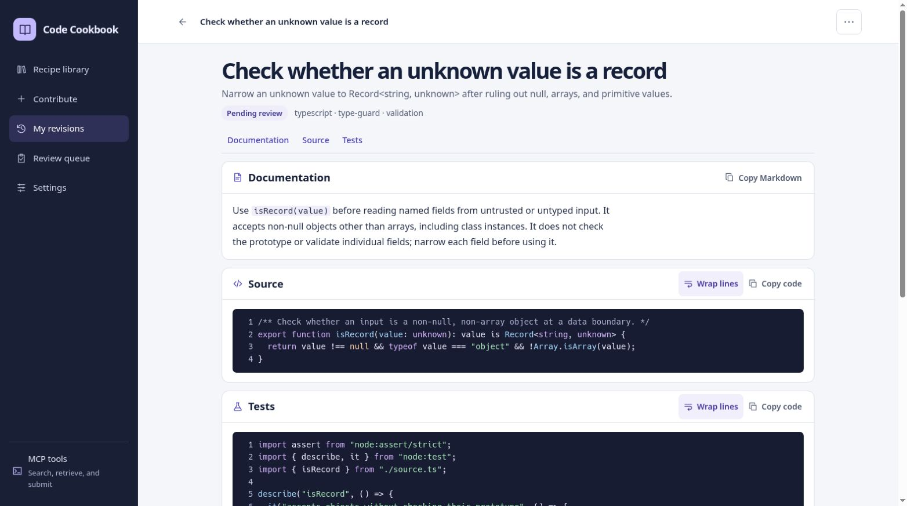

# Code Cookbook

Bist is a shared library for reusing code, ideas, architecture specs, and agent instructions
across ChatGPT, Codex, and other AI tools. Save work from a ChatGPT conversation as a recipe
and reuse it in another tool through the Model Context Protocol (MCP). Other connected
MCP clients can submit recipes for reuse in ChatGPT too.

**Keep Bist private.** Bist is designed for teams of trusted users and agents.
Avoid public deployments.

Start with [one prompt in ChatGPT Sites](#install-a-private-instance-with-chatgpt-sites).
Sites hosts Bist, so you don't need to run a server.

Bist runs configurable, deterministic checks for formatting, lint, types, CSS, and duplicates.
Optional OpenAI API review checks new or changed content against your written rules.
Maintainers compare revisions and leave private comments on files or lines, including Markdown,
before approving and publishing.



This guide covers the `develop` branch. Hosted instances may run an earlier version.

## Install a private instance with ChatGPT Sites

If your account has Sites access, select `@Sites` in ChatGPT on the web or in the desktop app.
Send this prompt. [ChatGPT Sites documentation](https://learn.chatgpt.com/docs/sites/creating-a-site)

```text
@Sites Deploy Bist (Code Cookbook) from the develop branch of
https://github.com/sendanor/bist as a new private ChatGPT Site. Use the existing
application and build instructions. Set up the D1 database binding named DB and
apply the repository migrations. Ask me which verified ChatGPT email should be a
maintainer and set MAINTAINER_EMAILS in the Sites runtime settings.
Publish with access limited to my account and MCP enabled. Give me the Site URL
and help me install and connect its private Code Cookbook plugin for ChatGPT and Codex.
```

After publication, open the plugin card from Sites or find **Code Cookbook** under
**Plugins → Personal → Created by you**. Choose **Install** and **Connect**.
Select the plugin in a new ChatGPT or Codex conversation and ask it to list your recipe
revisions. A fresh instance returns an empty list.
[ChatGPT MCP installation guide](https://learn.chatgpt.com/docs/extend/mcp#3-publish-and-install)

If Sites asks for local source, use the checkout below in the ChatGPT desktop app.
To join an existing instance, open its URL and sign in with ChatGPT. The operator manages access.

## Share with your team

- **Private team library.** Limit access to your team and set review rules for its coding
  conventions, architecture, and agent instructions. Review instructions before publishing.
  Agents may act on malicious instructions in recipes they read.
- **Separate project libraries.** Deploy a Site with its own D1 database for each project.
  Each instance has its own recipes, access settings, and review rules. Install each MCP plugin
  separately and pick it with `@` in ChatGPT or Codex. For example, choose `@mummowiki` or
  `@pappawiki` if those are the names shown for your plugins.

## Try it locally

You need Git, Bash, Node.js 24 with npm, and npm registry access. The local preview uses
test data and a synthetic maintainer account. It needs no ChatGPT account or hosted database.

```sh
git clone --branch develop https://github.com/sendanor/bist.git
cd bist
npm ci
npm run build
```

Follow the [local preview guide](docs/local-preview.md) and open `http://127.0.0.1:8787/`.
In **Contribute**, select **Fill with example**, then **Submit for review**. The example opens as
**Pending review**. Use **Revision actions** to approve and publish it. Then find **Batch items
into chunks** in the library. The guide includes a [runnable MCP request](docs/local-preview.md#try-mcp).

## Use recipes

A recipe can contain code, interfaces, tests, CSS, documentation, or agent instructions.
Documentation or instructions can stand alone. Bist stores and checks tests as text.
Run them in the project where you reuse the code.

Edit your own unapproved revision in place. Start a new revision to improve an approved or
published one. Approval applies to one snapshot. Publishing sets the default version in search.
See the [recipe workflow](docs/recipe-workflow.md) for review comments and removal.

Find recipes by keyword or tag in the browser or with `search_recipes` over MCP.
Use `get_recipe` to fetch a published revision or selected files.
See [MCP tools and submission fields](docs/recipe-workflow.md#use-mcp).

## Configure an instance

- **Hosting.** Bist runs as a Cloudflare Worker on ChatGPT Sites with a D1 binding named `DB`.
  Apply the [D1 migrations](drizzle/). Copy the [example manifest](.openai/hosting.example.json)
  to the Git-ignored `.openai/hosting.json` and set `project_id`. In hosted runtime settings,
  set `MAINTAINER_EMAILS` to a comma-separated list of verified ChatGPT email addresses.
  Keep deployment settings and credentials outside the public repository.
- **Code policy.** Set deterministic checks under **Settings → Code policy**.
  See the [quality policy](QUALITY.md) for defaults and scope.
- **LLM review.** On a fresh instance, saving an OpenAI key and model enables checks
  for all six file types. Set rules or opt out under **Settings → LLM review** before connecting.
  See [review settings and defaults](docs/recipe-workflow.md#configure-llm-review).

### OpenAI assistant

The optional **Assistant** lets maintainers ask about published recipes. Bist sends recent
messages and selected published excerpts to OpenAI. The chat stays in the open browser tab.
The assistant can search published recipes and read source and documentation. Drafts and
private review feedback stay outside its tool scope.

Set the `SETTINGS_ENCRYPTION_KEY` deployment secret to 32 random bytes encoded as 64 hexadecimal characters.
Keep a secure copy separate from D1 backups. Under **Settings → OpenAI**, save a restricted
project key with **List models (Read)** and **Responses API (Write)**. Choose and save a model
that supports Responses and function calling. Check catalog access in Settings and verify
inference with a question in **Assistant**.
[OpenAI integration guide](docs/openai-integration.md)

Bist encrypts the key in D1 and displays only whether it is configured. Maintainers can change
the model or replace or remove the key without redeploying. When upgrading from an
environment-configured release, enter the key and model in Settings, then remove
`OPENAI_API_KEY` and `OPENAI_MODEL` from the deployment. If the encryption key changes or is
lost, enter the OpenAI key again.

## Development

From the repository root, after `npm ci`, run the checks and tests.

```sh
npm run check
npm test
```

Run `npm run check:coverage` for the 100% coverage gate. Tests use Miniflare and a temporary
database for submission, review, publication, and retrieval. They run trusted fixtures in a
separate project. See [AGENTS.md](AGENTS.md) for contribution rules and
[HANDOFF.md](HANDOFF.md) for project history.

Report bugs and request features through [GitHub Issues](https://github.com/sendanor/bist/issues).
The repository lists no separate security reporting channel.

## License

[MIT License](LICENSE).
